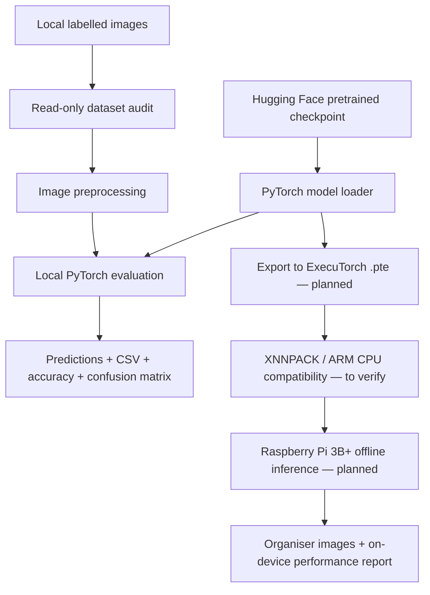

# ♻️ EcoSort Edge — Offline AI for Waste Classification


> **Namma AI Hackathon 2026 · PS3 — AI for Sustainability: Edge-Based Waste Sorting and Food Categorisation**

**EcoSort Edge** is a lightweight, privacy-conscious proof of concept for classifying everyday waste images using pretrained computer-vision models. The team has built and tested a **local PyTorch evaluation pipeline** and is preparing to deploy the selected classifier **offline via ExecuTorch on a Raspberry Pi 3 Model B+**.

**Current status:** Dataset audit and laptop-based evaluations are complete. **ExecuTorch export and Raspberry Pi inference have not yet been verified.**

---

## 📌 Problem Statement & Social Impact

Improper segregation of mixed waste makes recycling harder, increases manual sorting effort and reduces opportunities for recovery. Smaller schools, community collection points and local facilities may not have reliable connectivity or the budget for cloud-dependent systems.

This project explores a practical alternative: **run an image classifier locally on a low-cost Raspberry Pi** and produce a category recommendation that a person can use during sorting.

The project addresses **Namma AI Hackathon PS3**. The organisers require a working offline Edge AI proof of concept—not a robot or complete waste-management application. Its final evaluation must process **10–20 organiser-provided labelled images** covering **at least two organiser-defined categories**, with a verified pretrained model running locally through **ExecuTorch on Raspberry Pi**.

## 🎯 Scope & Mandatory Deliverables

- [x] Build a local dataset auditing pipeline and test pretrained classifiers on development hardware.
- [x] Generate reproducible local predictions, accuracy summaries and confusion matrices.
- [ ] Confirm the organiser-provided labels and the chosen model's category compatibility.
- [ ] Run a verified pretrained classifier through **ExecuTorch on Raspberry Pi** using 10–20 organiser-provided labelled images.
- [ ] Output one predicted category per image and show **at least two sample outputs**.
- [ ] Report predicted-versus-actual labels, total correct classifications and **accuracy**.
- [ ] Record model name, approximate **on-device inference time**, and model size or memory usage where measurable.
- [ ] Present a **maximum two-minute** explanation of the beneficiaries, realistic sorting scenario and offline advantage.

> **Not required by PS3:** Training a new network, physical sorting hardware, robotics, a live camera, a mobile app or a complex dashboard.

---

## 🚀 What Works Today

- **Read-only dataset audit:** Detects class folders, valid images, formats and unreadable files without modifying them.
- **Two pretrained Hugging Face model adapters:** TrashNet ResNet18 and MobileNetV3-Small, with strict checkpoint loading.
- **Explicit category mapping:** Rejects incompatible labels unless an intentional mapping and class subset are supplied.
- **Reproducible CPU evaluation:** Exports per-image predictions, class-wise metrics, accuracy and confusion matrices.
- **Transparent benchmarking:** Separates forward-pass latency from image preprocessing; stores run metadata and checkpoint/image hashes.
- **Local-only data:** Raw images, downloaded checkpoints, Hugging Face caches and evaluation artifacts are Git-ignored.

### 🧪 Local Evaluation Results

The results below come from **PyTorch CPU inference on a development laptop**, using selected classes from an independently downloaded local waste-image dataset. They are **not** ExecuTorch or Raspberry Pi benchmarks and must not be presented as final organiser-image results.

| Pretrained model | Evaluated categories | Images | Correct | Accuracy |
| --- | --- | ---: | ---: | ---: |
| [TrashNet ResNet18](https://huggingface.co/tonghahaha/trashnet-resnet18) | Glass, Plastics | 2,124 | 739 | **34.79%** |
| [MobileNetV3-Small](https://huggingface.co/TheHelltaker/smart-waste-segregator) | Glass, Plastics | 2,124 | 1,653 | **77.82%** |
| MobileNetV3-Small | Glass, Plastics, Aluminium | 3,143 | 2,400 | **76.36%** |
| **MobileNetV3-Small** | **Glass, Plastics, Aluminium, Organic Waste** | **4,196** | **3,436** | **81.89%** |

MobileNetV3's four-category test used these **explicit, provisional category equivalences**: `Glass → glass`, `Plastics → plastic`, `Aluminium → metal`, `Organic_Waste → biodegradable`. Category equivalence should be reviewed against the training taxonomy and example images before final reporting.

| Dataset category | Evaluated as | Images | Correct | Recall on this class |
| --- | --- | ---: | ---: | ---: |
| Glass | `glass` | 1,089 | 950 | 87.24% |
| Plastics | `plastic` | 1,035 | 703 | 67.92% |
| Aluminium | `metal` | 1,019 | 747 | 73.31% |
| Organic_Waste | `biodegradable` | 1,053 | 1,036 | 98.39% |

**Interpretation:** MobileNetV3-Small is the current deployment candidate, **not a proven on-device solution**. Differences in source datasets, category coverage and preprocessing may affect generalisation. The 34.79% ResNet18 figure and 81.89% MobileNetV3 figure cover **different evaluation sets** and should not be treated as a controlled head-to-head comparison. Results are preliminary until dataset overlap, label mappings and checkpoint preprocessing are verified.

---

## 🏗️ System Architecture



The **development laptop** handles checkpoint acquisition, model loading, evaluation and future export. The **Raspberry Pi 3B+** is intended to run the exported `.pte` artifact through ExecuTorch without cloud inference. The native runtime and XNNPACK compatibility on this older Pi still require validation.

## 🧰 Technology Stack

| Layer | Technology | Status |
| --- | --- | --- |
| Language | Python 3.11+ | Used for local evaluation |
| ML inference and evaluation | PyTorch, torchvision | Implemented locally |
| Model distribution | Hugging Face Hub | Implemented locally |
| Image handling | Pillow, OpenCV, NumPy | Implemented locally |
| Metrics and plots | scikit-learn, Matplotlib | Implemented locally |
| Edge deployment | ExecuTorch + XNNPACK (CPU) | **Planned / pending validation** |
| Target device | Raspberry Pi 3 Model B+ (1 GB RAM) | **Deployment pending** |
| Collaboration | Git and GitHub feature branches | In use |

### Model candidates

| Model | Architecture | Native output classes | Role |
| --- | --- | --- | --- |
| [tonghahaha/trashnet-resnet18](https://huggingface.co/tonghahaha/trashnet-resnet18) | ResNet18 with custom 6-class head | cardboard, glass, metal, paper, plastic, trash | Baseline |
| [TheHelltaker/smart-waste-segregator](https://huggingface.co/TheHelltaker/smart-waste-segregator) | MobileNetV3-Small with 4-class head | metal, plastic, glass, biodegradable | **Leading candidate** |
| [Arm MobileNetV3-Small INT8 ExecuTorch](https://huggingface.co/Arm/mobilenet-v3-small-int8-xnnpack-executorch) | ImageNet classifier | 1,000 ImageNet classes | Optional runtime smoke test; **not a waste-specific model** |

A checkpoint being available on Hugging Face does **not** mean that it already runs under ExecuTorch. Export, prediction-parity checks and target-device runtime testing are separate steps.

---

## 📊 Local Dataset

The existing development dataset contains **8,346 readable images across nine classes**. It stays on each developer's local machine and is intentionally **not** stored in the repository.

| Local category | Images |
| --- | ---: |
| Aluminium | 1,019 |
| Carton | 533 |
| E-waste | 1,029 |
| Glass | 1,089 |
| Organic_Waste | 1,053 |
| Paper_and_Cardboard | 1,194 |
| Plastics | 1,035 |
| Textiles | 830 |
| Wood | 564 |
| **Total** | **8,346** |

**Important:** The local dataset's nine classes do not automatically correspond to the output labels of either pretrained classifier. Unsupported or composite categories are not forced into arbitrary output labels. The final hackathon test must use the **organiser-provided images and their defined labels**.

## 📂 Repository Structure

The structure below reflects the **`feature/model-evaluation` branch**; ignored local directories appear only on machines where data or results have been generated.

```text
AI-for-Sustainability-Edge-Based-Waste-Sorting-and-Food-Categorisation/
├── README.md                     # Project overview and evaluation guide
├── .gitignore                    # Excludes dataset, weights and local artifacts
├── setup_dataset.py              # Optional Kaggle dataset downloader; do not rerun unnecessarily
├── requirements.txt              # Local PyTorch evaluation dependencies
├── label_map.json                # Glass / Plastics mapping
├── label_map_2.json              # Four-class MobileNetV3 mapping
├── src/
│   ├── __init__.py
│   ├── dataset_audit.py          # Read-only image audit and dataset discovery
│   ├── model_loader.py           # Verified pretrained model adapters
│   └── evaluate.py               # Predictions, metrics and confusion matrices
├── tests/
│   └── test_pipeline.py          # Pipeline checks using temporary example files
├── dataset/                      # LOCAL ONLY — ignored by Git
│   └── Waste Images/
│       ├── Aluminium/
│       ├── Glass/
│       └── ...
├── .hf_cache/                    # LOCAL ONLY — cached Hugging Face checkpoints
└── results/
    └── local/                    # LOCAL ONLY — run summaries, CSVs, plots
```

---

## ⚡ Quick Start (Windows PowerShell)

### 1. Clone the evaluation branch

```powershell
git clone --branch feature/model-evaluation https://github.com/matpat07/AI-for-Sustainability-Edge-Based-Waste-Sorting-and-Food-Categorisation.git
cd AI-for-Sustainability-Edge-Based-Waste-Sorting-and-Food-Categorisation
```

If you already cloned the repository, **use your existing project folder**. Do not download the dataset again.

### 2. Create or reuse your Python environment

```powershell
py -m venv .venv
.\.venv\Scripts\Activate.ps1
python -m pip install -r requirements.txt
```

Skip `py -m venv .venv` if the existing environment already works. Dependencies for evaluation should not be confused with the additional tooling needed later for ExecuTorch export.

### 3. Audit the local dataset

```powershell
python -m src.dataset_audit --data-dir "dataset"
```

For an external directory, use `--data-dir "D:\Datasets\Waste Images"` with your real local path.

### 4. Run a selected-class model evaluation

**TrashNet ResNet18 — Glass and Plastics:**

```powershell
python -m src.evaluate --data-dir "dataset" --model "tonghahaha/trashnet-resnet18" --classes Glass Plastics --label-map "label_map.json"
```

**MobileNetV3-Small — four mapped categories:**

```powershell
python -m src.evaluate --data-dir "dataset" --model "TheHelltaker/smart-waste-segregator" --classes Glass Plastics Aluminium Organic_Waste --label-map "label_map_2.json"
```

The first run downloads the selected checkpoint into the ignored `.hf_cache/`; the source dataset is **not** downloaded by these evaluation commands. The script rejects category mismatches rather than guessing labels.

### 5. Inspect your results

Each run creates a timestamped directory under `results/local/` containing:

- `predictions.csv` — original label, mapped target label, prediction and timing
- `summary.json` — accuracy, class metrics and run metadata
- `confusion_matrix.csv` and `confusion_matrix.png` — prediction breakdown

```powershell
Get-ChildItem "results\local" -Directory | Sort-Object LastWriteTime -Descending | Select-Object -First 5
```

### 6. Run the test suite

```powershell
python -m unittest discover -s tests -v
```

> Results are local-only by design. The dataset, cache and raw confusion-matrix images are not automatically included in GitHub commits.

---

## 🛠️ Deployment Roadmap

| Phase | Deliverable | Status |
| --- | --- | --- |
| 1 | Audit 8,346 local images and validate dataset structure | ✅ Completed |
| 2 | Test pretrained ResNet18 and MobileNetV3 on selected categories | ✅ Completed |
| 3 | Confirm checkpoint class order, preprocessing, dataset independence and organiser label compatibility | 🔍 Validation pending |
| 4 | Export selected PyTorch model to ExecuTorch `.pte` and check output parity | ⏳ Planned |
| 5 | Verify Raspberry Pi 3B+ 64-bit OS and ExecuTorch/XNNPACK runtime | ⏳ Planned |
| 6 | Run offline on-device classification and measure inference time / memory | ⏳ Planned |
| 7 | Evaluate organiser-supplied 10–20 labelled images and prepare impact explanation | ⏳ Final challenge |

### Raspberry Pi 3B+ deployment constraints

The Pi 3B+ has an Arm Cortex-A53 CPU and **1 GB RAM**. The [Arm ExecuTorch course](https://learn.arm.com/courses/executorch-on-arm/) primarily demonstrates workflows on a more powerful Raspberry Pi 5. **Do not assume its prebuilt runtime, wheels or timing results work unchanged on the Pi 3B+.** The team will test the 64-bit OS, ExecuTorch runtime and CPU backend, and may need a native C++ runner rather than a full Python/PyTorch stack.

## 👥 Team & Responsibilities

| Member | Focus | Planned ownership |
| --- | --- | --- |
| Maher | ML engineering | Pretrained models, evaluation, export and model comparison |
| Soumya | Evaluation and integration | Input pipeline, reporting, documentation and demonstration |
| Parth | Embedded deployment | Raspberry Pi OS, native runtime, performance profiling and compatibility |

Responsibilities are a proposed division of work and can be adjusted as the project progresses.

## 🔐 Reproducibility, Ethics & Limitations

- **Pretrained models:** All reported models were obtained from their original repositories; do not imply that the team trained them from scratch.
- **Licensing:** Check the license of each model, underlying dataset and any borrowed code independently. This repository does **not** claim a project-wide MIT license unless the team adds a valid `LICENSE` file.
- **Evaluation integrity:** Preprocessing and class-index mappings must match the original checkpoints; training-set overlap and category mismatch can overstate generalisation.
- **No cloud inference in the final demo:** Local PyTorch laptop testing is preparation; the hackathon requires **local ExecuTorch inference on Raspberry Pi**.
- **No unsafe automation:** Predicted categories are decision support, not guaranteed physical sorting instructions. E-waste and other hazardous materials require appropriate handling regardless of model output.
- **Dataset privacy:** The local testing dataset, model caches and generated detailed reports are intentionally Git-ignored. Only publish data or example images when permitted by their licenses.

## 📚 References

- [Namma AI Hackathon — official event page](https://www.coe-iot.com/namma-ai-hackathon/)
- [ExecuTorch on Arm — official learning course](https://learn.arm.com/courses/executorch-on-arm/)
- [ExecuTorch documentation](https://docs.pytorch.org/executorch/stable/)
- [TrashNet ResNet18 on Hugging Face](https://huggingface.co/tonghahaha/trashnet-resnet18)
- [MobileNetV3-Small waste model on Hugging Face](https://huggingface.co/TheHelltaker/smart-waste-segregator)
- [Arm MobileNetV3-Small INT8 reference on Hugging Face](https://huggingface.co/Arm/mobilenet-v3-small-int8-xnnpack-executorch)
- [PyTorch](https://pytorch.org/) · [Raspberry Pi](https://www.raspberrypi.com/)

---

**Built for Namma AI Hackathon 2026 · PCCOE, Pune.**

*This README documents measured local progress and planned on-device milestones. Raspberry Pi deployment and the organiser-provided final evaluation remain pending.*
